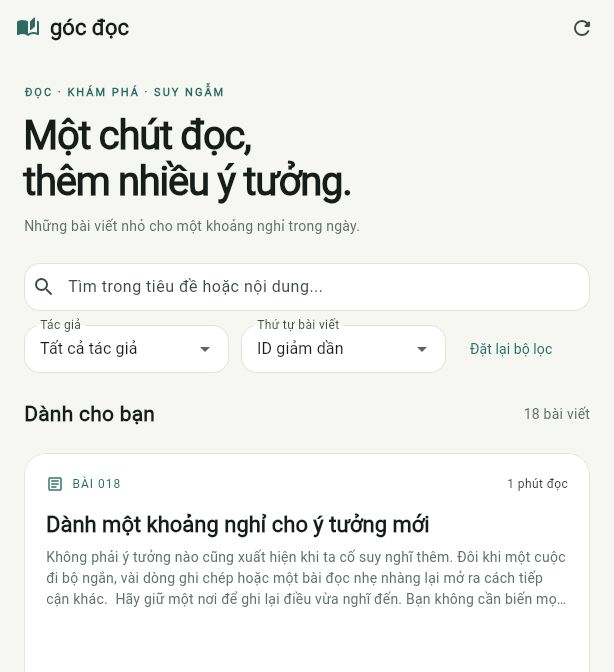
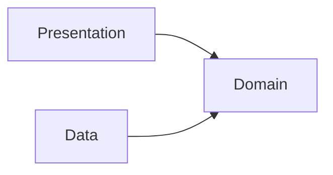

# Góc đọc

Ứng dụng đọc bài viết bằng **Flutter và Dart**, với giao diện tiếng Việt, tìm kiếm, lọc theo tác giả và xem nội dung chi tiết. Dự án minh họa cách tổ chức ứng dụng theo **Clean Architecture**, kết hợp Repository, UseCase và Dependency Injection.



## Tính năng

- Xem danh sách và chi tiết bài viết từ REST API.
- Tìm kiếm trong tiêu đề và nội dung, không phân biệt chữ hoa và chữ thường.
- Lọc theo tác giả, sắp xếp theo ID tăng hoặc giảm dần.
- Tải lại dữ liệu bằng nút bấm hoặc thao tác kéo xuống.
- Hiển thị trạng thái đang tải, danh sách rỗng và lỗi có nút thử lại.
- Bố cục thích ứng với kích thước màn hình.
- Chọn nguồn dữ liệu qua cấu hình: API công khai, API tiếng Việt đi kèm hoặc dữ liệu mẫu trong ứng dụng.

## Yêu cầu môi trường

- **Flutter stable >= 3.41**, đi kèm **Dart >= 3.11**.
- Chrome hoặc Edge để chạy Web.
- Android SDK và JDK tương thích với Flutter nếu chạy hoặc build Android.

Phiên bản đã kiểm tra: **Flutter 3.47.7 / Dart 3.13.5**. Giữ `pubspec.lock` để sử dụng các phiên bản thư viện đã được ghi nhận trong dự án.

Kiểm tra công cụ trên máy:

```sh
flutter doctor -v
```

## Cài đặt

```sh
git clone https://github.com/Khoa56/flutter-clean-architecture-demo.git
cd flutter-clean-architecture-demo
flutter pub get
```

Nếu tải dự án bằng **Code → Download ZIP**, giải nén rồi mở terminal trong thư mục chứa `pubspec.yaml` trước khi chạy các lệnh tiếp theo.

## Chạy Web với nội dung tiếng Việt

Bản này sử dụng 18 bài viết mẫu tiếng Việt và REST API viết bằng Dart đi kèm dự án.

```sh
flutter build web --release --no-web-resources-cdn --dart-define=API_BASE_URL=/api/
dart run tool/demo_server.dart
```

Mở **[http://127.0.0.1:8788/](http://127.0.0.1:8788/)** trong trình duyệt. Giữ terminal đang chạy; nhấn **Ctrl+C** để dừng máy chủ.

Máy chủ phục vụ cả giao diện Web trong `build/web` và API tại `/api/`. Đường dẫn API được giải quyết theo địa chỉ Web hiện tại. Địa chỉ `127.0.0.1` chỉ truy cập trên máy đang chạy dự án.

Đổi cổng nếu cần:

```sh
dart run tool/demo_server.dart --port=8789
```

Sau đó mở `http://127.0.0.1:8789/`.

### Cập nhật bài viết

Chỉnh sửa `assets/content/posts_vi.json`, sau đó khởi động lại máy chủ. Mỗi bài viết có cấu trúc:

```json
{
  "id": 1,
  "userId": 1,
  "title": "Bắt đầu từ một việc nhỏ",
  "body": "Nội dung bài viết bằng tiếng Việt."
}
```

`id` và `userId` là số nguyên dương; mỗi bài cần có ID riêng. `title` là chuỗi không rỗng và `body` là chuỗi nội dung.

Các endpoint của API đi kèm:

| Phương thức | Đường dẫn | Nội dung |
| --- | --- | --- |
| GET | `/api/posts` | Danh sách bài viết |
| GET | `/api/posts/{id}` | Chi tiết một bài viết; trả HTTP 404 nếu không tồn tại |

## Các chế độ dữ liệu khác

### API công khai

Khi không truyền cấu hình, ứng dụng dùng [JSONPlaceholder](https://jsonplaceholder.typicode.com/) với nội dung mẫu tiếng Anh/Latin:

```sh
flutter run -d chrome
```

Có thể thay `chrome` bằng `edge` nếu trình duyệt đó có trong kết quả `flutter devices`. Chế độ này gọi trực tiếp `/posts` và `/posts/{id}` trên API công khai, không cần chạy máy chủ Dart đi kèm.

### Dữ liệu mẫu tích hợp

Chạy giao diện với 6 bài viết tiếng Việt trong asset, không cần máy chủ API:

```sh
flutter run -d chrome --dart-define=USE_FIXTURE=true
```

Ứng dụng hiển thị nhãn **“Đang dùng dữ liệu mẫu”**. Chế độ này chọn `PostFixtureDataSource` tại nơi cấu hình DI; ứng dụng không tự chuyển sang dữ liệu mẫu khi API gặp lỗi.

### API tùy chỉnh

Ví dụ cấu hình rõ địa chỉ API:

```sh
flutter run -d chrome --dart-define=API_BASE_URL=https://jsonplaceholder.typicode.com/
```

| Cấu hình | Mặc định | Ý nghĩa |
| --- | --- | --- |
| `API_BASE_URL` | `https://jsonplaceholder.typicode.com/` | URL gốc của API; kết thúc bằng `/` |
| `USE_FIXTURE` | `false` | Chọn dữ liệu mẫu trong asset thay cho API |

API tùy chỉnh cần đáp ứng các endpoint `posts`, `posts/{id}` và cấu trúc JSON nêu trên. Khi chạy Web với API khác nguồn, máy chủ API cần cho phép CORS. Giá trị `/api/` tương đối dùng cho bản Web được phục vụ cùng máy chủ API.

Các giá trị `--dart-define` được xác định khi biên dịch. Chạy lại hoặc build lại ứng dụng sau khi thay đổi cấu hình.

## Chạy trên Android

Chuẩn bị Android SDK, JDK và điện thoại bật USB debugging hoặc Android Emulator. Dùng `flutter doctor -v` để kiểm tra môi trường, rồi thực hiện bước giấy phép bằng `flutter doctor --android-licenses` nếu công cụ yêu cầu.

Liệt kê thiết bị và chạy ứng dụng:

```sh
flutter devices
flutter run -d <DEVICE_ID>
```

Thay `<DEVICE_ID>` bằng ID thiết bị Android trong danh sách. Mặc định ứng dụng dùng API công khai; có thể thêm `--dart-define=USE_FIXTURE=true` để chạy bằng dữ liệu mẫu tiếng Việt trong asset.

Build APK:

```sh
flutter build apk --release
```

Kết quả ở `build/app/outputs/flutter-apk/app-release.apk`. Cấu hình hiện tại dùng khóa ký debug để chạy thử; cần thiết lập khóa phát hành riêng khi phát hành ứng dụng.

Mã nguồn cũng có bộ khung Windows. Để build Windows desktop, chuẩn bị công cụ C++ mà `flutter doctor` yêu cầu.

## Kiến trúc

Ứng dụng chia thành ba tầng:

| Tầng | Trách nhiệm |
| --- | --- |
| **Presentation** | Widget, điều hướng và trạng thái màn hình qua Cubit |
| **Domain** | Entity, hợp đồng Repository, UseCase và quy tắc tìm/lọc |
| **Data** | Gọi HTTP, đọc dữ liệu mẫu, chuyển JSON thành Model/Entity và xử lý lỗi hạ tầng |

Hướng phụ thuộc mã nguồn:



Domain sử dụng Dart thuần. Presentation làm việc với UseCase; Data triển khai hợp đồng Repository do Domain định nghĩa. Các dependency được ghép tại `lib/core/di/` bằng **GetIt + injectable** và truyền qua constructor.

Luồng một yêu cầu tải bài viết:

```text
Widget → Cubit → UseCase → Repository → DataSource → REST API
```

Repository chuyển phản hồi thành Entity hoặc lỗi Domain trước khi trả về. Cubit cập nhật trạng thái để giao diện hiển thị kết quả.

## Cấu trúc thư mục

```text
lib/
  main.dart                  # Khởi tạo ứng dụng, DI và provider
  app.dart                   # Giao diện chung, theme và ngôn ngữ
  core/
    config/                  # Cấu hình nguồn dữ liệu
    di/                      # Module và mã đăng ký dependency
  features/posts/
    domain/                  # Entity, Repository interface, UseCase
    data/                    # Model, DataSource, Repository implementation
    presentation/            # Cubit, màn hình và widget
assets/
  content/                   # Bài viết cho API tiếng Việt
  fixtures/                  # Dữ liệu mẫu tích hợp trong ứng dụng
test/                        # Unit, widget, DI và kiểm tra kiến trúc
tool/                        # Máy chủ Dart và công cụ kiểm tra API
docs/                        # Tài liệu bổ sung và ảnh minh họa
android/                     # Cấu hình nền tảng Android
web/                         # Cấu hình nền tảng Web
windows/                     # Cấu hình nền tảng Windows
```

## Kiểm tra mã nguồn

```sh
dart format --output=none --set-exit-if-changed lib test tool
flutter analyze
flutter test --coverage
```

Chạy riêng các test Domain và quy tắc phụ thuộc:

```sh
flutter test test/domain test/architecture --reporter expanded
```

Test Domain dùng Mocktail để thay thế Repository, không gọi mạng. Bộ kiểm thử còn kiểm tra lỗi HTTP/JSON, trạng thái Cubit, cấu hình DI và thao tác trên giao diện. Báo cáo coverage được tạo tại `coverage/lcov.info`.

Kiểm tra kết nối tới API công khai:

```sh
dart run tool/check_api.dart
```

Sau khi thay đổi khai báo DI trong `lib/core/di/reader_module.dart`, sinh lại mã đăng ký:

```sh
dart run build_runner build
```

`injection.config.dart` đã có trong mã nguồn để có thể chạy ngay sau khi tải dependency.

## Script tiện ích trên Windows

Chạy tại thư mục gốc dự án bằng PowerShell:

| Lệnh | Chức năng |
| --- | --- |
| `.\CHAY_WEB.ps1` | Build và mở máy chủ Web/API tiếng Việt |
| `.\CHAY_DEMO.ps1 -Device edge` | Chạy ứng dụng bằng API công khai |
| `.\CHAY_DEMO.ps1 -Device edge -Sample` | Chạy ứng dụng bằng dữ liệu mẫu |
| `.\KIEM_TRA.ps1` | Phân tích mã và chạy test có coverage |
| `.\BUILD_APK.ps1` | Build APK release |

Các script nhận `-FlutterSdk <đường-dẫn-SDK>` khi Flutter chưa có trong PATH. Nếu máy không cho chạy script PowerShell, dùng các lệnh Flutter/Dart tương ứng ở trên.

## Đóng góp

Khi đề xuất thay đổi, mô tả vấn đề hoặc tính năng, cách kiểm tra và kết quả mong đợi. Với thay đổi nghiệp vụ, bổ sung test cho hành vi mới và chạy `flutter analyze`, `flutter test` trước khi gửi pull request.

## Tài liệu tham khảo

- [Kiến trúc ứng dụng Flutter](https://docs.flutter.dev/app-architecture)
- [Dependency Injection trong Flutter](https://docs.flutter.dev/app-architecture/case-study/dependency-injection)
- [GetIt](https://pub.dev/packages/get_it)
- [injectable](https://pub.dev/packages/injectable)
- [flutter_bloc](https://pub.dev/packages/flutter_bloc)
- [HTTP](https://pub.dev/packages/http)
- [Mocktail](https://pub.dev/packages/mocktail)
