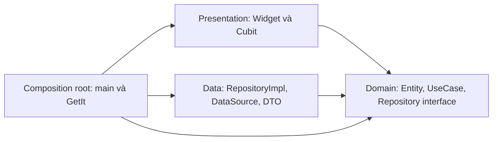
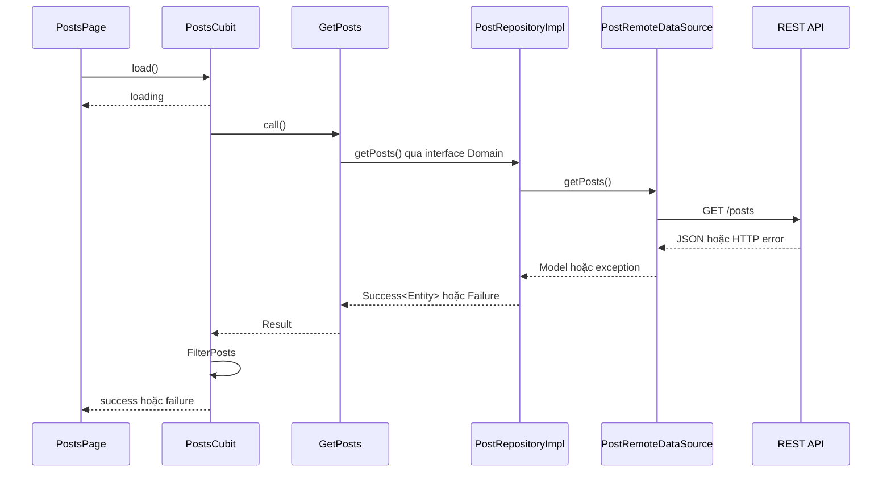

# Giải thích kiến trúc và mã nguồn

## Hướng phụ thuộc và luồng chạy

Mũi tên sau là hướng import/biết đến, không phải thứ tự gọi ở runtime:



Luồng tải danh sách:



Runtime gọi được Data thông qua dispatch của interface; Presentation không cần import Data. Domain không biết Flutter, HTTP hoặc GetIt. Composition root nằm ngoài các tầng và được phép biết implementation để ghép object.

## Các lớp then chốt

**Post và PostModel:** Entity chứa dữ liệu nghiệp vụ, không có `fromJson`. DTO ở Data kiểm tra cấu trúc JSON và map `userId` thành `authorId`. Server đổi JSON thì trước tiên sửa Model, không đưa logic parse vào widget.

**PostRepository:** hợp đồng thuộc Domain, có `getPosts()` và `getPost(id)`. `PostRepositoryImpl` thuộc Data implements hợp đồng, chuyển Model sang Entity và chuyển exception thành `AppFailure`.

**UseCase:** `GetPosts` biểu diễn tác vụ lấy danh sách; hiện chủ yếu ủy quyền, không có quy tắc phức tạp. `GetPostDetail` từ chối ID <=0 trước khi gọi repository. `FilterPosts` xử lý tìm/lọc/sắp xếp không sửa list đầu vào.

**Cubit:** thuộc Presentation, chỉ nhận UseCase qua constructor. UI không tự tạo repository, không gọi HTTP và không gọi GetIt. Màn hình chi tiết gọi endpoint chi tiết riêng.

## DI, DIP và vòng đời

DIP là nguyên lý: logic cấp cao phụ thuộc abstraction, chi tiết cũng phụ thuộc abstraction. DI là kỹ thuật: dependency được cung cấp từ bên ngoài. Có DI nhưng constructor chỉ nhận lớp HTTP cụ thể thì chưa minh họa đủ DIP.

`core/di/injection.dart` đăng ký object graph:

```text
HTTP Client -> PostDataSource -> PostRepository -> UseCase -> Cubit
```

| Object | Lifetime | Lý do |
| --- | --- | --- |
| AppConfig | Singleton | Một cấu hình cho lần chạy |
| HTTP Client | Lazy singleton + dispose | Dùng chung kết nối, đóng khi container reset |
| DataSource / Repository / UseCase | Lazy singleton | Tạo khi cần và tái sử dụng |
| Cubit | Factory | State và vòng đời riêng của từng màn hình |

GetIt chỉ được truy cập trong `main` và `core/di`. Các lớp khác nhận dependency qua constructor. `BlocProvider(create: ...)` sở hữu Cubit và tự close khi bị gỡ khỏi widget tree; provider của trang chi tiết nằm trong route đó.

`WidgetsFlutterBinding.ensureInitialized()` chuẩn bị binding trước khi setup có thể dùng Flutter services/assets. `MultiBlocProvider` gắn Cubit danh sách vào cây widget; chi tiết dùng provider riêng.

`reader_module.dart` sử dụng `@module`, `@lazySingleton` và module method để khai báo object graph. `injectable` sinh `injection.config.dart` với các lệnh đăng ký GetIt. Annotation nằm ở composition root nên Domain không phải import thư viện DI. Chạy `dart run build_runner build` khi thay đổi khai báo, không chỉnh file sinh tự động bằng tay.

Config và HTTP client được đăng ký sẵn trong `configureDependencies`; hai kiểu này nằm trong `ignoreUnregisteredTypes` vì chúng được cung cấp thủ công trước khi gọi `container.init()`. HTTP client có callback dispose; các object ứng dụng còn lại được generator đăng ký.

## Lỗi và xử lý bất đồng bộ

Repository map timeout, mất kết nối, HTTP 404, lỗi server, JSON sai và lỗi bất ngờ thành kiểu lỗi Domain. UI chỉ dịch loại lỗi thành thông báo tiếng Việt. Success với list rỗng khác Failure; không dùng fixture để che lỗi API.

Mỗi lần tải có request ID. Kết quả cũ không ghi đè kết quả mới. `isClosed` ngăn emit khi người dùng đã thoát trang. Đây là bỏ qua kết quả lỗi thời, **không phải hủy HTTP request thực sự**. Timeout 12 giây giới hạn thời gian chờ nhưng `Future.timeout` không tự hủy kết nối đang chạy.

## Kiểm thử chứng minh sự độc lập

`test/domain/usecases_test.dart` tạo `MockPostRepository extends Mock implements PostRepository`. Mocktail thiết lập success/failure và xác minh số lần gọi. Không tạo DataSource hay dùng Internet. Source Domain chỉ import Dart SDK và file trong Domain.

`test/architecture` quét import/export để phát hiện Domain phụ thuộc tầng ngoài và Presentation phụ thuộc Data/HTTP/GetIt. Đây là bằng chứng tự động cho code hiện có, không phải chứng minh hình thức cho mọi kiểu vi phạm trong dự án lớn.

`test/di` kiểm tra lazy singleton, factory và đổi DataSource. Widget test nạp fixture trước bằng đồng hồ thật rồi inject loader để tránh phụ thuộc I/O trong fake clock; luồng Model -> Repository -> UseCase -> Cubit -> Widget vẫn chạy.

## Câu hỏi phản biện

**Chia ba thư mục có đủ không?** Không. Phải kiểm tra hướng phụ thuộc và trách nhiệm. Widget gọi HTTP hoặc Domain import Data là vi phạm thiết kế đang trình bày.

**Vì sao interface ở Domain?** Vì nó mô tả hợp đồng nghiệp vụ cần. Nếu UseCase phải import Data để biết interface, chiều phụ thuộc đã sai mục tiêu này.

**Đổi API sang nguồn khác cần sửa gì?** Viết implementation theo hợp đồng và thay đăng ký tại composition root. `USE_FIXTURE=true` minh họa điều này; UI/UseCase giữ nguyên.

**DI có phải quản lý trạng thái không?** Không. GetIt lắp ghép dependency; Cubit quản lý trạng thái màn hình.

**Vì sao chưa có database/đăng nhập?** Chủ đề 04 tập trung REST API, kiến trúc, DI, test Domain; demo giữ phạm vi đủ rõ để giải thích trong 5 phút.
